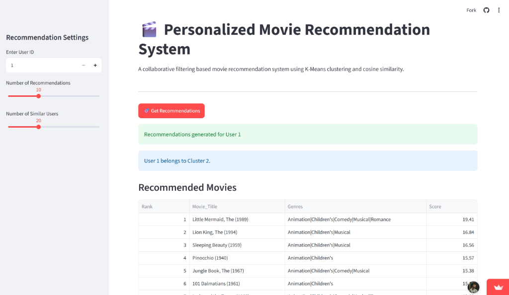
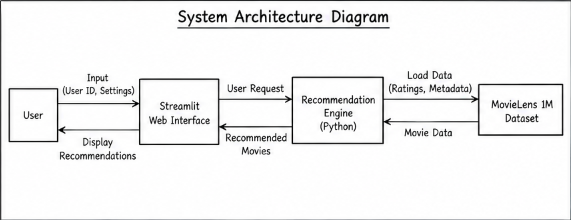
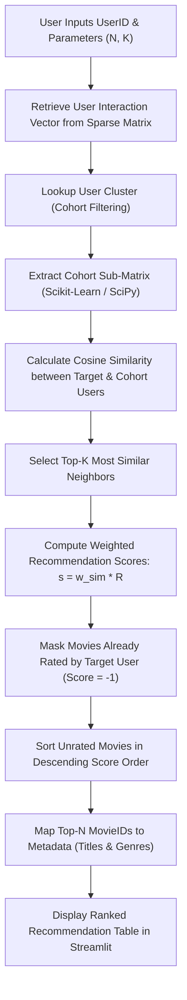
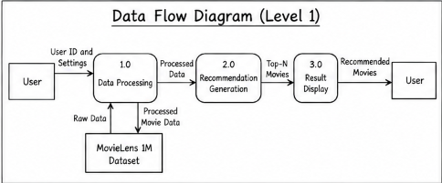

# 🎬 Personalized Movie Recommendation System Using Collaborative Filtering

[](https://personalized-movie-recommendation-systemm.streamlit.app/)
[](https://github.com/itskiishan/personalized-movie-recommendation-system)
[](https://www.python.org/)
[](https://scikit-learn.org/)

An end-to-end, machine learning-driven movie recommendation engine developed using **User-Based Collaborative Filtering (UBCF)** and **Cosine Similarity** on the **MovieLens 1M** dataset. The system analyzes user rating behavior to discover like-minded viewing patterns, computes weighted preference scores, and serves real-time, personalized Top-N movie recommendations through an interactive **Streamlit** web application.

---

## 🌐 Live Demo & Repository Links

- **🚀 Live Application:** [personalized-movie-recommendation-systemm.streamlit.app](https://personalized-movie-recommendation-systemm.streamlit.app/)
- **💻 Source Code:** [github.com/itskiishan/personalized-movie-recommendation-system](https://github.com/itskiishan/personalized-movie-recommendation-system)

<div align="center">
  
  <p><em>Figure 1: Streamlit interactive interface showing personalized movie recommendations generated for User 1.</em></p>
</div>

---

## 🎓 HCL Training Acknowledgement

This project was developed by **Kishan Kumar** as part of the **HCL** training program conducted from **28 September 2026 to 1 October 2026**, under the mentorship and technical guidance of **Mr. Himesh Singh** (Technical Trainer).

| Attribute | Details |
| :--- | :--- |
| **Training Organization** | HCL |
| **Project Title** | Personalized Movie Recommendation System Using Collaborative Filtering |
| **Training Period** | 28 September 2026 – 1 October 2026 |
| **Project Mentor** | Himesh Singh (Technical Trainer) |
| **Project Author** | Kishan Kumar |

> **Acknowledgement:** Sincere thanks to **HCL** for organizing the training program and providing this practical learning opportunity. Special gratitude is extended to **Mr. Himesh Singh** for his valuable guidance, technical insights, and supportive review throughout the development of this recommendation system project.

---

## 📖 Table of Contents

- [HCL Training Acknowledgement](#-hcl-training-acknowledgement)
- [Project Overview](#-project-overview)
- [Key Features](#-key-features)
- [System Architecture & Workflow](#-system-architecture--workflow)
- [How the Recommendation System Works](#-how-the-recommendation-system-works)
- [Recommendation Algorithm: User-Based Collaborative Filtering](#-recommendation-algorithm-user-based-collaborative-filtering)
- [Cosine Similarity Formulation](#-cosine-similarity-formulation)
- [Dataset Information & Statistics](#-dataset-information--statistics)
- [Model Evaluation & Performance Metrics](#-model-evaluation--performance-metrics)
- [Technologies & Libraries Used](#-technologies--libraries-used)
- [Project Directory Structure](#-project-directory-structure)
- [Installation & Setup Instructions](#-installation--setup-instructions)
- [Running the Streamlit Application](#-running-the-streamlit-application)
- [Future Improvements](#-future-improvements)
- [Author & Mentorship](#-author--mentorship)
- [Dataset Attribution & License Information](#-dataset-attribution--license-information)

---

## 📌 Project Overview

Modern digital streaming platforms host tens of thousands of titles, causing **information overload** where users spend excessive time searching for films rather than enjoying them. Traditional keyword search and genre filters are non-personalized and fail to capture implicit nuances in personal taste.

This project delivers an automated, data-driven solution:
1. **User-Centric Profiling:** Encodes user rating histories into high-dimensional preference vectors.
2. **Behavioral Similarity Discovery:** Uses Cosine Similarity to identify neighborhood clusters of users with similar film evaluations.
3. **Collaborative Recommendation Scoring:** Predicts user preference for unrated movies by aggregating ratings weighted by peer similarity.
4. **Interactive Deployment:** Implements a lightweight, sparse matrix-backed Streamlit application providing responsive, interactive recommendations across 6,040 users and 3,883 movies.

---

## ✨ Key Features

- **Personalized Top-N Recommendations:** Generates ordered movie rankings uniquely customized to any target user ID in the dataset.
- **Novelty Filtering (Seen-Item Masking):** Automatically filters out movies the target user has already evaluated, guaranteeing that every suggestion represents an unviewed discovery.
- **Tunable Neighborhood Parameters:** Interactive sidebar controls allow users to adjust the number of recommendations (5 to 20) and the pool of similar users (5 to 50).
- **High-Performance Sparse Representations:** Implements `scipy.sparse.csr_matrix` for compact, in-memory representation, compressing the 6,040 × 3,706 rating matrix to just ~12 MB while avoiding memory bottlenecks.
- **Empirically Validated Methodology:** Rigorously benchmarked using a 20% holdout test of positive user ratings ($\text{Rating} \ge 4$) evaluated across 100 users for Precision@10, Recall@10, and Catalog Coverage.
- **Clean Responsive Dashboard:** Built with Streamlit, providing clean tabular views of movie titles, associated genres, and computed recommendation confidence scores.

---

## 🏗️ System Architecture & Workflow

### 1. System Architecture Diagram

The system operates across three tiers: the **Presentation Layer** (Streamlit Web Interface), the **Inference Layer** (Python Recommendation Engine with sparse matrix operations), and the **Data Storage Layer** (Serialized MovieLens Deployment Artifacts).

<div align="center">
  
  <p><em>Figure 2: System Architecture Diagram depicting data and control flow across components.</em></p>
</div>

### 2. End-to-End Recommendation Pipeline



### 3. Recommendation Workflow (Data Flow Diagram Level 1)

<div align="center">
  
  <p><em>Figure 3: Data Flow Diagram (Level 1) representing internal processing stages.</em></p>
</div>

---

## ⚙️ How the Recommendation System Works

The recommendation pipeline executes the following deterministic steps:

1. **User Profile Retrieval:** Given a target user $u$, the application extracts their rating vector from the sparse interaction matrix.
2. **Cohort Partitioning:** The user's precomputed cluster assignment (generated via K-Means during preprocessing) scopes candidate users into a relevant taste cohort for efficient comparison.
3. **Similarity Assessment:** Cosine similarity is computed between the target user vector and candidate user vectors in the cohort.
4. **Neighbor Selection:** The top $K$ users with highest positive similarity scores are selected as nearest neighbors.
5. **Weighted Rating Aggregation:** Candidate movie scores are computed by taking the dot product of neighbor similarity weights and neighbor rating vectors:

$$
\mathbf{s} = \mathbf{w}_{\text{sim}} \cdot \mathbf{R}_{\text{neighbors}}
$$

6. **Masking Previously Rated Movies:** Any movie already rated by the target user has its score set to $-1$, ensuring existing watches are never recommended.
7. **Ranking & Metadata Enrichment:** Indices corresponding to the top $N$ scoring movies are sorted in descending order and matched against movie metadata to return ranked titles and genre tags.

---

## 🧠 Recommendation Algorithm: User-Based Collaborative Filtering

### Core Methodology
**Collaborative Filtering (CF)** operates on the premise that individuals who agreed on items in the past are likely to agree on items in the future. In **User-Based Collaborative Filtering (UBCF)**:
- Users are the active entities.
- Recommendations are formed by finding a neighborhood of peer users whose historical evaluations align closely with the target user.
- Unlike Content-Based Filtering, UBCF requires no manual feature engineering (e.g., actor tags, plot summaries, keywords) and naturally captures serendipitous, cross-genre recommendations based on observed human preferences.

### Algorithmic Comparison: Baseline CF vs. Clustered CF
During development and experimental benchmarking, two architectural strategies were evaluated:
1. **Pure Baseline User-Based CF:** Computes pairwise similarity across the entire user population.
2. **K-Means Clustered CF ($k=5$):** Pre-segments users into behavioral clusters before calculating similarity within the identified cluster.

```
                      ┌──────────────────────────────────────────────┐
                      │    MovieLens 1M User-Movie Rating Matrix     │
                      └──────────────────────┬───────────────────────┘
                                             │
                   ┌─────────────────────────┴─────────────────────────┐
                   ▼                                                   ▼
┌──────────────────────────────────────┐            ┌──────────────────────────────────────┐
│  Baseline Collaborative Filtering    │            │     K-Means Assisted Clustering      │
│  • Neighborhood: All 6,040 Users     │            │  • Partitions users into k=5 cohorts │
│  • Precision@10: 0.3050              │            │  • Precision@10: 0.2990              │
│  • Recall@10: 0.2395                 │            │  • Recall@10: 0.2352                 │
│  • Catalog Coverage: 8.45%           │            │  • Scoped similarity search          │
└──────────────────┬───────────────────┘            └──────────────────┬───────────────────┘
                   │                                                   │
                   │ ★ Final Primary Recommendation Methodology        │
                   └───────────────────────────────────────────────────┘
```

> **Evaluation Insight:** As documented in `model_evaluation.ipynb`, the pure User-Based Collaborative Filtering model achieved superior Precision@10 (**0.3050**) and Recall@10 (**0.2395**) over the K-Means clustered variation (**0.2990** and **0.2352**). Consequently, **User-Based Collaborative Filtering is established as the final primary recommendation methodology**, while cluster assignments are used in deployment to narrow candidate users for efficient computation.

---

## 📐 Cosine Similarity Formulation

### 1. Vector Space Representation

Let the dataset define a set of $m$ users $\mathcal{U}$ and a set of $n$ movies $\mathcal{I}$:

$$
\mathcal{U} = \{u_1, u_2, \dots, u_m\}, \quad \mathcal{I} = \{i_1, i_2, \dots, i_n\}
$$

Each user $u$ is represented by an $n$-dimensional sparse rating vector:

$$
\mathbf{r}_u = [r_{u, 1}, r_{u, 2}, \dots, r_{u, n}] \in \mathbb{R}^n
$$

where each entry $r_{u, i}$ represents the rating assigned by user $u$ to movie $i$ (with $0$ indicating an unrated movie):

$$
r_{u, i} \in \{1, 2, 3, 4, 5\} \quad (\text{or } 0 \text{ if unrated})
$$

### 2. Cosine Similarity Equation

The similarity between target user $u$ and neighbor user $v$ is measured as the cosine of the angle between their rating vectors:

$$
\text{Cosine Similarity}(u, v) = \cos(\theta) = \frac{\mathbf{r}_u \cdot \mathbf{r}_v}{\|\mathbf{r}_u\|_2 \|\mathbf{r}_v\|_2} = \frac{\sum_{i=1}^{n} r_{u,i} \cdot r_{v,i}}{\sqrt{\sum_{i=1}^{n} r_{u,i}^2} \cdot \sqrt{\sum_{i=1}^{n} r_{v,i}^2}}
$$

Where:
- The numerator represents the vector dot product of ratings between users $u$ and $v$.
- The denominator represents the product of their Euclidean ($L_2$) vector norms:

$$
\mathbf{r}_u \cdot \mathbf{r}_v = \sum_{i=1}^{n} r_{u, i} \cdot r_{v, i}, \quad \|\mathbf{r}_u\|_2 = \sqrt{\sum_{i=1}^{n} r_{u, i}^2}
$$

- Similarity values range between $0$ (orthogonal preferences) and $1$ (identical relative rating patterns).

### 3. Prediction Score Computation

The predicted interest score for target user $u$ on an unrated movie $i$ is computed as the similarity-weighted sum of ratings from the top-$K$ most similar users:

$$
\hat{r}_{u, i} = \sum_{v \in \mathcal{N}_K(u)} \text{sim}(u, v) \cdot r_{v, i}
$$

---

## 📊 Dataset Information & Statistics

The project uses the benchmark **MovieLens 1M** dataset provided by **GroupLens Research** at the University of Minnesota.

### Summary Statistics

| Attribute | Verified Value | Description |
| :--- | :---: | :--- |
| **Total Ratings** | **1,000,209** | Explicit integer ratings on a 1–5 scale |
| **Total Users** | **6,040** | Validated user demographic profiles |
| **Unique Movies in Ratings** | **3,706** | Movies with at least one historical rating |
| **Total Movies in Catalog** | **3,883** | Total catalog items in `movies.dat` |
| **Average Rating** | **3.58 / 5.0** | Overall mean rating across all user submissions |
| **Matrix Dimensions** | **6,040 × 3,706** | User-Movie interaction matrix |
| **Matrix Sparsity** | **~95.53%** | Proportion of unobserved user-movie pairs |
| **Duplicate / Invalid Records** | **0** | Verified through rigorous data validation |

### Rating Value Distribution

| Rating | Count | Percentage | Visual Representation |
| :---: | :---: | :---: | :--- |
| ⭐ 1 | 56,174 | 5.62% | `██` |
| ⭐⭐ 2 | 107,557 | 10.75% | `████` |
| ⭐⭐⭐ 3 | 261,197 | 26.11% | `██████████` |
| ⭐⭐⭐⭐ 4 | 348,971 | 34.89% | `█████████████` |
| ⭐⭐⭐⭐⭐ 5 | 226,310 | 22.63% | `█████████` |

---

## 📈 Model Evaluation & Performance Metrics

### Evaluation Methodology
The evaluation follows a standard offline hold-out testing protocol designed in `model_evaluation.ipynb`:
1. **Sample Cohort:** 100 representative users were randomly selected.
2. **Positive Preference Threshold:** Positive ratings were defined as ratings of 4 or 5 ($\text{Rating} \ge 4$), representing true positive preferences.
3. **Hold-Out Split:** For each evaluation user, 20% of their positive ratings were masked from the training matrix and sequestered into a ground-truth test set $\mathcal{T}_u$.
4. **Top-10 Inference:** The recommendation engine produced its Top-10 suggestions $\mathcal{R}_u$ for each evaluation user without access to held-out ratings.

### Formal Metric Definitions

- **Precision@10:** Measures recommendation precision — the proportion of top-10 recommended movies that the user genuinely rated positively ($\text{Rating} \ge 4$) in the hidden test set:

$$
\text{Precision@10} = \frac{1}{|\mathcal{U}_{\text{eval}}|} \sum_{u \in \mathcal{U}_{\text{eval}}} \frac{|\mathcal{R}_u \cap \mathcal{T}_u|}{10}
$$

- **Recall@10:** Measures coverage of relevant items — the proportion of the user's hidden positive test items that the algorithm successfully recovered:

$$
\text{Recall@10} = \frac{1}{|\mathcal{U}_{\text{eval}}|} \sum_{u \in \mathcal{U}_{\text{eval}}} \frac{|\mathcal{R}_u \cap \mathcal{T}_u|}{|\mathcal{T}_u|}
$$

- **Catalog Coverage:** Measures the diversity and breadth of the catalog explored by recommendations:

$$
\text{Catalog Coverage} = \frac{|\bigcup_{u \in \mathcal{U}_{\text{eval}}} \mathcal{R}_u|}{M_{\text{train}}} \times 100\%
$$

### Empirical Evaluation Results

| Metric | Baseline Collaborative Filtering |
| :--- | :---: |
| **Precision@10** | 0.3050 |
| **Recall@10** | 0.2395 |
| **Catalog Coverage** | 8.45% |

### Comparative Model Summary

| Model Architecture | Precision@10 | Recall@10 | Catalog Coverage |
| :--- | :---: | :---: | :---: |
| **User-Based Collaborative Filtering (Baseline)** | **0.3050** | **0.2395** | **8.45%** (313 unique / 3,706 movies) |
| K-Means + Collaborative Filtering | 0.2990 | 0.2352 | — |

### Hyperparameter Sensitivity (Similar User Count $K$)

During model evaluation, the neighbor count parameter $K$ was systematically swept across values of $[5, 10, 20, 30, 50]$. Across all tested values, the model maintained consistent, stable Precision@10 of **0.3050** and Recall@10 of **0.2395**, demonstrating algorithm stability across varied neighborhood densities.

---

## 💻 Technologies & Libraries Used

| Technology | Category | Purpose |
| :--- | :--- | :--- |
| **Python** (3.10+) | Programming Language | Core backend language and execution environment |
| **Streamlit** (v1.x) | Web Framework | Interactive user interface, sliders, and real-time dashboard |
| **Pandas** | Data Processing | Tabular data manipulation, ingestion of `.dat` and `.csv` files |
| **NumPy** | Numerical Computation | High-performance array indexing, masking, and linear algebra |
| **Scikit-Learn** | Machine Learning | Cosine similarity calculation (`cosine_similarity`) and K-Means |
| **SciPy** | Scientific Computing | Compressed Sparse Row (`csr_matrix`) memory-efficient structures |
| **Pickle** | Model Persistence | Binary serialization of deployment-ready feature matrices |

---

## 📂 Project Directory Structure

```
personalized-movie-recommendation-system/
│
├── .gitignore                          # Git ignore specification
├── README.md                           # Comprehensive project documentation
├── app.py                              # Main Streamlit web application
├── requirements.txt                    # Project dependencies
│
├── movie_recommendation_cf.ipynb       # Model training, sparse matrices & pipeline
├── model_evaluation.ipynb              # Precision@10, Recall@10 & coverage evaluation
│
├── assets/                             # README diagram & visual assets
│   ├── streamlit_app.png               # Live Streamlit application interface screenshot
│   ├── system_architecture.png         # Multi-tier system architecture diagram
│   └── recommendation_workflow.png     # Level 1 Data Flow Diagram (workflow)
│
└── model/
    └── deployment/                     # Lightweight deployment artifacts for Streamlit
        ├── movie_features.pkl          # Movie metadata DataFrame (ID, Title, Genres)
        ├── movie_ids.pkl               # Array of 3,706 distinct MovieIDs
        ├── sparse_feature_matrix.pkl   # Compressed Sparse Row (CSR) rating matrix (~12 MB)
        ├── user_clusters.pkl           # User cluster mappings DataFrame (6,040 rows)
        └── user_ids.pkl                # Array of 6,040 unique UserIDs
```

### Deployment Artifact Details

The production application in `app.py` loads lightweight serialized objects directly from `model/deployment/` to ensure efficient startup and execution without needing raw dataset parsing:
- `sparse_feature_matrix.pkl`: 6,040 × 3,706 `scipy.sparse.csr_matrix` containing non-zero ratings.
- `user_ids.pkl`: Index-to-UserID lookup array.
- `movie_ids.pkl`: Index-to-MovieID lookup array.
- `user_clusters.pkl`: User cluster labels mapped from unsupervised clustering.
- `movie_features.pkl`: Clean metadata mapping movie IDs to sanitized titles and genre tags.

---

## 🚀 Installation & Setup Instructions

### Prerequisites
- Python 3.10 or higher installed on your operating system.
- Git installed on your system.

### 1. Clone the Repository
```bash
git clone https://github.com/itskiishan/personalized-movie-recommendation-system.git
cd personalized-movie-recommendation-system
```

### 2. Create a Virtual Environment
- **Windows (Command Prompt / PowerShell):**
  ```powershell
  python -m venv venv
  .\venv\Scripts\activate
  ```
- **macOS / Linux:**
  ```bash
  python3 -m venv venv
  source venv/bin/activate
  ```

### 3. Install Dependencies
```bash
pip install --upgrade pip
pip install -r requirements.txt
```

---

## 🖥️ Running the Streamlit Application

Ensure your virtual environment is active and all deployment files exist in `model/deployment/`.

### Launch the Application
```bash
streamlit run app.py
```

Upon launching, Streamlit will display local and network access URLs:
```
  Local URL: http://localhost:8501
  Network URL: http://192.168.x.x:8501
```

### Using the Interface
1. **Enter User ID:** Input any valid user ID between `1` and `6040` in the sidebar.
2. **Set Number of Recommendations:** Select how many movie suggestions to return (between `5` and `20`, default: `10`).
3. **Set Number of Similar Users:** Choose the neighborhood size $K$ of peers to aggregate (between `5` and `50`, default: `20`).
4. **Click "🎯 Get Recommendations":** The engine computes cosine similarities, filters already-rated movies, and displays ranked suggestions with genre tags and match scores.

---

## 🔮 Future Improvements

- [ ] **Hybrid Recommendation Architecture:** Combine Collaborative Filtering with Content-Based TF-IDF or BERT embeddings on plot summaries to mitigate the cold-start problem for newly released movies.
- [ ] **Matrix Factorization (SVD / ALS):** Implement Singular Value Decomposition or Alternating Least Squares to capture latent factors and further compress the interaction matrix.
- [ ] **New User Onboarding (Cold Start):** Implement an interactive rating survey in Streamlit allowing first-time users to rate 5 popular movies to generate an instant user profile.
- [ ] **Temporal Dynamics:** Incorporate rating timestamps to decay older preferences and weight recent viewing trends more heavily.
- [ ] **Poster & Trailer Integration:** Connect with The Movie Database (TMDB) API to dynamically render movie posters, release dates, and trailer links.

---

## 👨‍💻 Author & Mentorship

- **Author:** **Kishan Kumar**
  - **Degree:** Bachelor of Technology (B.Tech) in Computer Science and Engineering
  - **Institution:** ABES Engineering College, Ghaziabad
  - **Academic Year:** 2026 – 2027
  - **GitHub:** [@itskiishan](https://github.com/itskiishan)

- **Project Mentor:** **Mr. Himesh Singh**
  - **Designation:** Technical Trainer

---

## 📜 Dataset Attribution & License Information

- **Dataset Source:** GroupLens Research, University of Minnesota ([grouplens.org/datasets/movielens/1m](https://grouplens.org/datasets/movielens/1m/))
- **Dataset Citation:** F. Maxwell Harper and Joseph A. Konstan. 2015. *The MovieLens Datasets: History and Context.* ACM Transactions on Interactive Intelligent Systems (TiiS) 5, 4, Article 19 (December 2015).
- **Dataset Terms:** The MovieLens 1M dataset is provided for academic, research, and non-commercial educational purposes.
- **Repository License:** No license has been specified for this repository.
